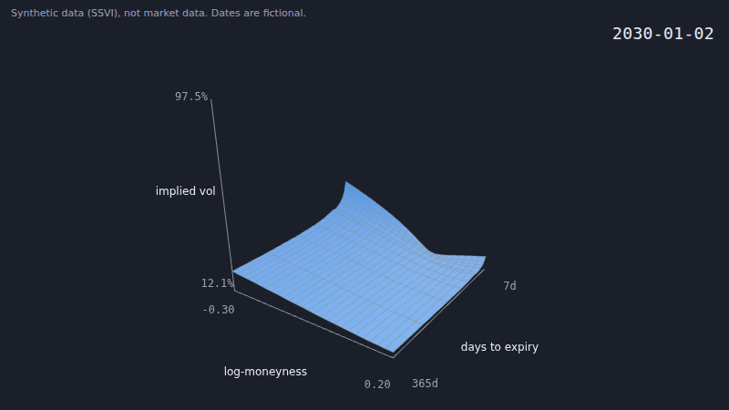

# vol-surface-cinema

An animated 3D implied-volatility surface that plays date by date, with deterministic GIF and MP4 export.

The data in this GIF is synthetic. It is not market data. It is not investment advice.

## Quick start

You need Node 22. Install the packages once.

    npm install

To run the page with live reload, use the dev server.

    npm run dev

Open `http://localhost:5173`. The page starts to play at once.

To make a static site, build it. Then serve the build.

    npm run build
    npm run preview

The build goes to `dist/`. Open `http://localhost:4173`. The page works offline. It loads no font and no script from a network.

## Controls

- Play or Pause button: starts or stops the animation.
- Scrubber: drag it to go to any frame.
- Date buttons: jump to a date. A date with an event also shows the event name.
- Dataset menu: select a dataset. The page reloads with that dataset.

Keys:

- `Space` plays or pauses.
- `ArrowLeft` goes back one frame.
- `ArrowRight` goes forward one frame.

Drag the surface to rotate it while the animation is paused.

The page reads these query parameters:

| Parameter | Value | Meaning |
|---|---|---|
| `dataset` | a dataset id | Selects the dataset. The id must be in `public/data/index.json`. |
| `fps` | 1 to 60 | Sets the frame rate. |
| `export` | `1` | Starts the export mode, with no controls. The export command uses this mode. |
| `w`, `h` | 16 to 4096 | Set the size of the stage in export mode. |

An invalid value is ignored.

## Export to GIF or MP4

Install the browser for the export once.

    npx playwright install chromium

The export also needs ffmpeg. Install it with your package manager. If ffmpeg is not on the path, set the `FFMPEG` environment variable to its path.

Do the export with this command. The directory of `--out` must exist.

    npm run export -- --format mp4 --dataset synthetic-regime-story --out demo.mp4

This example makes a small GIF of the real dataset.

    npm run export -- --format gif --dataset optionsdx-spy-4dates --fps 10 --size 640x360 --out spy.gif

The command builds the page first. Then it draws each frame in a headless browser and sends the frames to ffmpeg.

| Flag | Meaning |
|---|---|
| `--format` | `gif`, `mp4` or `frames-json`. |
| `--dataset` | A dataset id. The default is the first dataset in the index. |
| `--fps` | 1 to 60. For a GIF, use 10, 20, 25 or 50. The default is 25 for a GIF, and the `playback.fps` of the dataset for an MP4. |
| `--size` | Width and height, as `WxH`. Both must be even, from 16 to 4096. The default is 1280x720 for MP4 and 800x450 for GIF. |
| `--out` | The output file. This flag is required. The extension must match the format. |
| `--force` | Overwrite an existing output file. Without this flag, the command stops if the file exists, also when it appears while the export runs. That file is never changed. |
| `--max-frames` | The most frames to render. The default is 10000. |
| `--gpu` | Use the GPU. By default, the export uses the software renderer SwiftShader. |

The exit codes are 2 (bad arguments), 3 (ffmpeg, browser or build missing), 4 (render or write failure, also when the output file appears during the run and `--force` is not set) and 5 (encode failure).

Frame `n` depends only on the dataset, `n`, the frame rate and the size. The same command gives the same frames on the same machine. The bytes of the MP4 or GIF can differ.

## The data

The default dataset is synthetic. The code `src/synth` generates it from a seeded SSVI model. The model has a fictional story with the dates in 2030: a calm period, a volatility spike, an FOMC decision and a recovery. The file is `public/data/synthetic-regime-story.json`.

The optional dataset is real. The file `public/data/optionsdx-spy-4dates.json` holds implied-volatility grids of SPY for four dates. It is derived from OptionsDX end-of-day quotes. To see it, select it in the dataset menu or open `?dataset=optionsdx-spy-4dates`.

The four dates are months or years apart. Each frame between two dates is interpolated. It is not observed, and the caption says so. The page also shows the share of cells that were extrapolated.

This is not market data for trading. This is not investment advice. The real grids are shown as they were exported. They are not repaired for arbitrage, and some of them have butterfly violations.

The licence of the real data is not the licence of the code. Read [DATA.md](DATA.md) for the sources and the terms.

## How the maths is checked

The synthetic surface must not allow arbitrage. Arbitrage is a risk-free profit. Two kinds apply to a surface of implied volatility:

- Calendar arbitrage. The total variance (the implied variance times the time to expiry) must not decrease when the expiry is later.
- Butterfly arbitrage. The implied density of the price must not be negative. A negative density means that a butterfly spread has a negative price.

The checks follow Gatheral and Jacquier (2014). The butterfly check has two parts. The function `g` must be at least zero at each strike. The slope of the right wing must be less than 2.

The tests check each date of the story, and 101 in-between surfaces for each pair of dates. Two independent checks validated the formulas. One check read the paper. The other check ran probes, and each probe fails on a changed formula. The review found one error. The first version of the butterfly check did not test the slope of the right wing. This is corrected. See [docs/validation/report.md](docs/validation/report.md).

The checks cover the synthetic data only. They do not cover the real dataset.

## Blender (optional)

The script `tools/blender/render_surface_sequence.py` can render the animation in Blender. It reads the file that the `frames-json` export makes.

Blender was not run for this project. Only the pure-Python half of the script is tested. This half checks the JSON file and computes the heights, the captions and the camera. The code that uses Blender (`bpy`) is not tested. Expect small errors on the first run in Blender.

## The data-file format

Each dataset is a JSON file of the type `surface-sequence` version 1. The file holds:

- a grid of log-moneyness and days to expiry
- a list of frames, with one IV grid for each date
- events, playback settings and a source notice

The page rejects a file that does not match the format. The full contract is in section 7 of [docs/design.md](docs/design.md).

## Tests

Run all the checks with this command. It runs the unit tests, the type check, the build and the Python tests.

    npm run verify

The Python tests need [uv](https://docs.astral.sh/uv/).

Run the end-to-end test of the export separately. It needs the browser and ffmpeg from the export section.

    npm run test:e2e

## Credits

- Parts of the geometry, colour and framing code come from [vol-strategy-backtester](https://github.com/rajib2k5/vol-strategy-backtester). [CREDITS.md](CREDITS.md) lists each file.
- The SSVI model and the no-arbitrage conditions are from Gatheral and Jacquier, "Arbitrage-free SVI volatility surfaces", Quantitative Finance, 2014 (arXiv:1204.0646).

## Licence

The code is under the MIT licence (see [LICENSE](LICENSE)). The data follows [DATA.md](DATA.md). The real dataset is not under the MIT licence.
